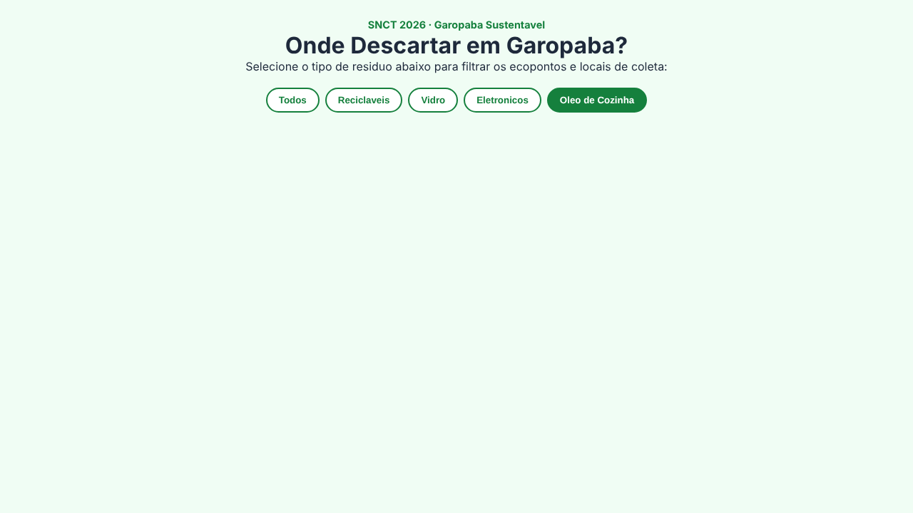
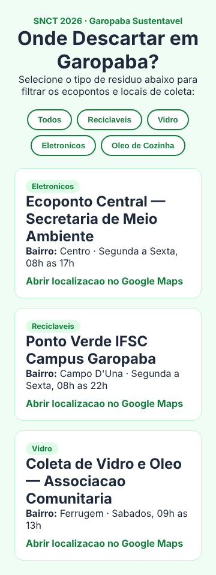

# Auditoria automatizada do Starter Kit (Fase 1)

- Data: 10/11/2026
- Kit auditado: https://github.com/fleithpi/sntc2026-starter-kit-curso2, branch `main`, commit `8d03680` (04/11/2026)
- Deploy auditado: https://fleithpi.github.io/sntc2026-starter-kit-curso2/
- Referência: Roteiro Prático SNCT 02 (PDF da Frente 2), Passos 2.5, 2.6 e 2.7
- Ferramenta: `ferramentas/testes-kit/` (Playwright 1.63, Chromium)

## Resultado geral

15 testes rodados: **10 passaram e 5 falharam**. As 5 falhas vêm de 3 problemas
do kit (dois deles aparecem no modo offline e no online). Cada um tem rascunho
de issue em [issues-frente2.md](issues-frente2.md). Nada foi corrigido no kit.

O kit **abre e funciona sem internet**: nenhum erro no Console, nenhuma
requisição falha, e o deploy do Pages é idêntico byte a byte ao `main`.

| # | Teste | Offline (`file://`) | Online (Pages) |
| --- | --- | --- | --- |
| 1 | Página carrega sem erros no Console e sem requisições falhas | Passou | Passou |
| 2 | Botão "Todos" mostra N cartões (N = `LOCAIS_COLETA.length` = 3) | Passou | Passou |
| 3 | Cada botão de filtro mostra pelo menos 1 cartão | **Falhou** | **Falhou** |
| 4 | Cada categoria do array tem botão correspondente (comparação exata) | Passou | Passou |
| 5 | Links do mapa com `target="_blank"` e `rel="noopener"` | Passou | Passou |
| 6 | Celular 360x740: sem rolagem horizontal; botões com 44 px de toque | **Falhou** | **Falhou** |
| 8 | `index.html` igual ao Passo 2.5 do PDF | Passou | não se aplica |
| 8 | `js/app.js` igual ao Passo 2.6 do PDF | **Falhou** | não se aplica |
| 8 | `css/estilo.css` igual ao Passo 2.7 do PDF | Passou | não se aplica |

O item 7 do plano (mesma suíte contra o deploy) é a coluna "Online".

## Falhas

### F1. Botão "Oleo de Cozinha" mostra a grade vazia (teste 3)

O botão chama `filtrarEcopontos('Oleo')`, mas nenhum item de `LOCAIS_COLETA`
tem `categoria: "Oleo"`. O local "Coleta de Vidro e Oleo" está cadastrado como
`"Vidro"`. Ao clicar, a tela fica em branco, sem nenhum aviso.



O mesmo defeito está no código do PDF (Passo 2.6). Corrigir só no repositório
criaria uma nova divergência com o roteiro impresso, então a correção precisa
ser combinada entre a Frente 2 e a Frente 1.

Impacto na bancada: o participante clica, não vê nada e acha que quebrou o
código. Enquanto não for corrigido, os monitores precisam saber que isso é
esperado. Issue 1.

### F2. Botões de filtro com 35 px de altura (teste 6)

No celular (360x740) os 5 botões medem 35 px de altura; o critério do nosso
plano é 44 px de área de toque. A largura está adequada (de 70 a 140 px) e
**não há rolagem horizontal**.



O CSS do repositório é igual ao do PDF (Passo 2.7), então também é uma
característica do roteiro. Gravidade baixa: os botões funcionam, só são um
pouco pequenos para o dedo. Issue 2.

### F3. `js/app.js` diferente do PDF em 3 linhas (teste 8)

Lista completa em [divergencias-pdf.md](divergencias-pdf.md). Resumo:

| Linha | No PDF (Passo 2.6) | No repositório |
| --- | --- | --- |
| 1 (PDF) | `// BLOCO 2: Adicione novos ecopontos ou pontos de entrega voluntaria de Garopaba` | linha ausente |
| 22 (PDF) / 21 (repo) | `mapaUrl: "https://maps.google.com/?q=Praia+da+Ferrugem+Garopaba"` | `mapaUrl: "https://maps.app.goo.gl/r5PxGL6jaeWf9rwJ7"` |

A falta do comentário `// BLOCO 2` é a mais importante: é o marcador que o
micro-roteiro usa para dizer ao participante onde editar. Issue 3.

`index.html` e `css/estilo.css` têm o mesmo conteúdo do PDF.

## Diferenças de formatação (não contam como falha)

O PDF não permite recuperar o recuo exato, por isso a comparação ignora recuo e
linhas em branco. Ainda assim, quem comparar o kit com o roteiro impresso vai
notar:

1. Recuo de 4 espaços no repositório; 2 espaços no PDF.
2. `css/estilo.css` tem uma declaração por linha (86 linhas); no PDF são 25
   linhas, com várias declarações juntas. Os números de linha do roteiro não
   servem para o CSS do kit.
3. `js/app.js` tem 40 linhas no repositório e 44 no PDF. O título do Passo 2.6
   fala em "32 linhas"; nenhuma das duas versões tem 32.
4. Dentro do `innerHTML`, o repositório não recua as linhas do cartão.
5. Os três arquivos terminam sem quebra de linha final.

Para os monitores: ao ajudar, apontar pelo **conteúdo da linha** ou pelo
marcador `BLOCO`, nunca pelo número da linha do PDF.

## Registros sem correção (item 3 do plano)

1. **Nome do repositório usa "sntc", não "snct".** O endereço é
   `sntc2026-starter-kit-curso2`, enquanto o evento, o Moodle e a chave usam
   "SNCT". Quem digitar o endereço de memória vai errar. Os QR Codes da Fase 5
   devem ser gerados a partir do endereço real, copiado e colado. Issue 4.
2. **O zip baixado do GitHub não é o pacote oficial.** O botão "Download ZIP"
   entrega `sntc2026-starter-kit-curso2-main.zip`, com tudo dentro da pasta
   `sntc2026-starter-kit-curso2-main/`. O nome oficial é
   `starter-kit-painel-verde.zip`, com a pasta `starter-kit-painel-verde/`. O
   pacote do Plano B (Fase 2) será montado com o nome oficial. Issue 5.

## Outras observações

1. O `README.md` do kit contém só "Starter Kit". O Passo 2.4 do PDF pede
   "instruções curtas para o participante da oficina". Issue 6.
2. Existe uma branch `fleithpi-patch-1` (03/11) que contém apenas um arquivo
   `Painel Verde.zip`, com nome diferente do oficial. Parece sobra de upload;
   vale a Frente 2 confirmar se pode ser apagada.
3. O código não usa jQuery nem LocalStorage. Segue o PDF da Frente 2 (JS puro);
   a divergência com o dashboard da UC continua registrada em
   [premissas.md](premissas.md).
4. O link do terceiro local é um endereço curto (`maps.app.goo.gl`). Funciona,
   mas não foi aberto pela auditoria: os testes conferem o formato do link, não
   o destino.

## Limites desta auditoria

1. Rodou só em Chromium. O laboratório tem Chrome e Firefox; falta rodar em
   Firefox (`npx playwright install firefox` numa máquina da equipe).
2. O modo offline foi simulado com `context.setOffline(true)`. O teste com o
   cabo de rede desconectado numa máquina do laboratório é manual (Fase 2).
3. A referência do PDF foi transcrita à mão das páginas 7 a 9 e conferida com a
   extração de texto do arquivo. Se a Frente 2 atualizar o PDF, atualizar
   `ferramentas/testes-kit/referencia-pdf/`.

## Como repetir

```bash
cd ferramentas/testes-kit
npm install
npx playwright install chromium
npx playwright test
node comparar-pdf.js
```

Para testar outra pasta (por exemplo, o Plano B da Fase 2):

```bash
KIT_DIR=../../saida/PLANO-B/starter-kit-painel-verde npx playwright test --project=offline
```

## Imagens

- [Kit no computador, filtro "Todos"](img/kit-desktop-todos.png)
- [Kit no celular 360x740](img/kit-celular-360x740.png)
- [Grade vazia no filtro "Oleo de Cozinha"](img/kit-filtro-vazio-oleo.png)
