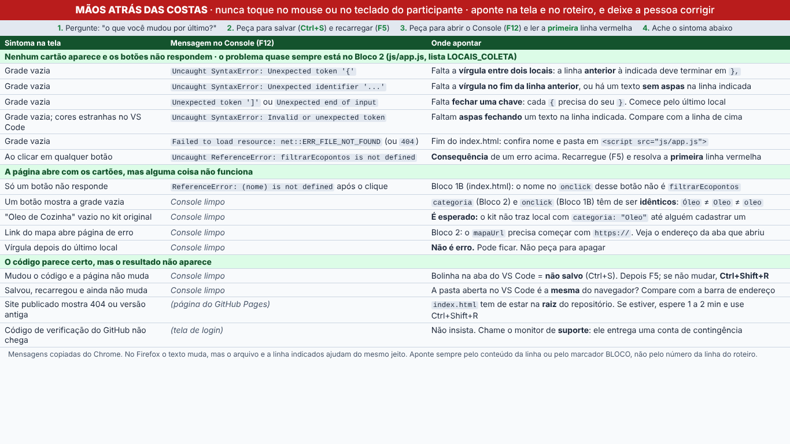

# Kit de treinamento de monitores (Fase 4)

- Data: 10/11/2026
- Base: Starter Kit no commit `8d03680` (`vendor/starter-kit`)
- Mensagens do Console capturadas no Chromium 153, abrindo por `file://`

## O que foi entregue

| Entrega | Onde | Situação |
| --- | --- | --- |
| 8 variantes do kit, cada uma com 1 alteração e `GABARITO.md` | `bancada/treino-erros/variante-N/` | Pronto |
| Cópias sem gabarito para o ensaio | `saida/TREINO/` (gerado, fora do git) | Pronto |
| Roteiro das 4 falhas que não cabem em arquivo | `bancada/treino-erros/FALHAS-SEM-ARQUIVO.md` | Pronto |
| Tela de triagem para os monitores | `bancada/triagem.html` | Pronto |
| Sorteio de 3 variantes por monitor com ficha de cronometragem | `ferramentas/rodizio-ensaio.py` | Pronto |
| Gerador das variantes e dos gabaritos | `ferramentas/gerar-treino-erros.js` | Pronto |

## As 8 variantes

| # | Alteração | Arquivo e linha | Console do Chrome ao abrir | Ao clicar |
| --- | --- | --- | --- | --- |
| 1 | Vírgula faltando entre dois locais | `js/app.js`, 8 | `Uncaught SyntaxError: Unexpected token '{'` (linha 9) | `filtrarEcopontos is not defined` |
| 2 | `}` não fechada no último local | `js/app.js`, 22 | `Uncaught SyntaxError: Unexpected token ']'` (linha 22) | `filtrarEcopontos is not defined` |
| 3 | Aspas não fechadas | `js/app.js`, 4 | `Uncaught SyntaxError: Invalid or unexpected token` (linha 4) | `filtrarEcopontos is not defined` |
| 4 | Categoria `"Óleo"` em vez de `"Oleo"` | `js/app.js`, 19 | limpo | limpo; "Oleo de Cozinha" e "Vidro" ficam vazios |
| 5 | `<script src="app.js">` | `index.html`, 30 | `Failed to load resource: net::ERR_FILE_NOT_FOUND` | `filtrarEcopontos is not defined` |
| 6 | `onclick="filtrarEcoponto('Vidro')"` | `index.html`, 23 | limpo | só em "Vidro": `Uncaught ReferenceError: filtrarEcoponto is not defined` (linha 23) |
| 7 | Vírgula sobrando no último local | `js/app.js`, 22 | limpo | limpo: **não é erro** |
| 8 | `mapaUrl` sem `https://` | `js/app.js`, 14 | limpo | limpo; o link abre `file:///.../maps.google.com/...` |

Na variante 1 o Console aponta a linha **seguinte** à do erro. É a pegadinha
mais útil para treinar: olhar a linha anterior à indicada.

## Aceite

| Critério do plano | Como foi conferido | Resultado |
| --- | --- | --- |
| Cada variante reproduz a mensagem do gabarito | `npx playwright test --project=treino` reabre as 8 pastas e compara o Console com o esperado, escrito à mão em `variantes.js` | 8 de 8 |
| Cada variante difere do kit em 1 arquivo só | Mesmo teste | 8 de 8 |
| Triagem cabe em 1 tela (1366x768) | Mesmo projeto de testes: sem rolagem em 1366x768 e em 1366x640 (janela com barras do navegador), sem nenhum recurso externo | Passou |



A triagem tem 15 linhas em 3 grupos. Além das mensagens das variantes, inclui
duas capturadas à parte por serem comuns: `Unexpected identifier '...'`
(vírgula faltando entre propriedades ou texto sem aspas) e
`Unexpected end of input` (chave da função não fechada).

## Limites

1. **Só Chrome/Chromium.** O laboratório também tem Firefox, e nele o texto das
   mensagens é outro. Não foi possível instalar o Firefox do Playwright neste
   ambiente (download bloqueado). Antes do ensaio, abrir as variantes 1, 2, 3,
   5 e 6 no Firefox do laboratório e anotar as mensagens.
2. **Fontes do laboratório.** A triagem usa a fonte padrão do sistema. Em outra
   máquina as linhas podem quebrar de forma diferente; conferir numa máquina do
   laboratório se continua sem rolagem (ou usar F11).
3. **"Onde apontar no roteiro".** A coluna aponta para os marcadores `BLOCO` e
   para os arquivos, porque o micro-roteiro da Frente 1 ainda não chegou.
   Quando chegar, acrescentar a página ou o passo correspondente.
4. **Mensagens com Live Server.** As capturas são de abertura por dois cliques.
   Com Live Server, o erro de arquivo não encontrado vira "404 (Not Found)".
5. O kit ainda não tem o comentário `// BLOCO 2` no `js/app.js` (issue 3 da
   Frente 2). Se a Frente 2 corrigir, as linhas mudam: rodar o gerador de novo.

## Como usar no ensaio de 21/11

```bash
node ferramentas/gerar-treino-erros.js
python3 ferramentas/rodizio-ensaio.py Nome1 Nome2 Nome3
```

1. Copiar `saida/TREINO/` (sem gabaritos) para as máquinas do ensaio.
2. Imprimir `saida/rodizio/fichas.html` (uma folha A4 deitada por monitor).
3. Seguir `bancada/treino-erros/LEIA-ME.md`.
